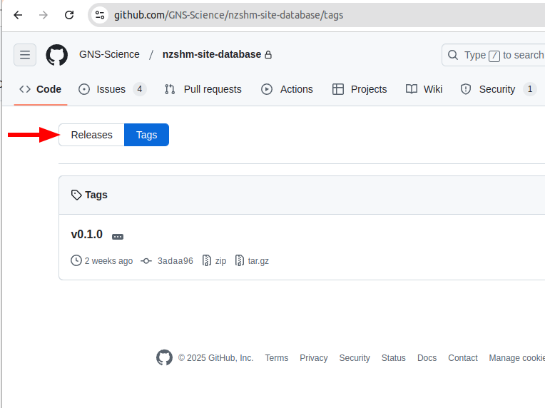
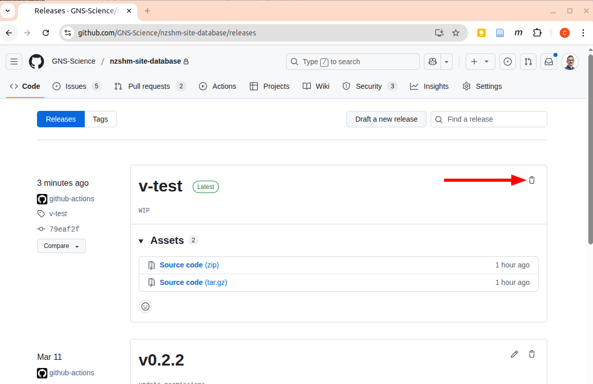
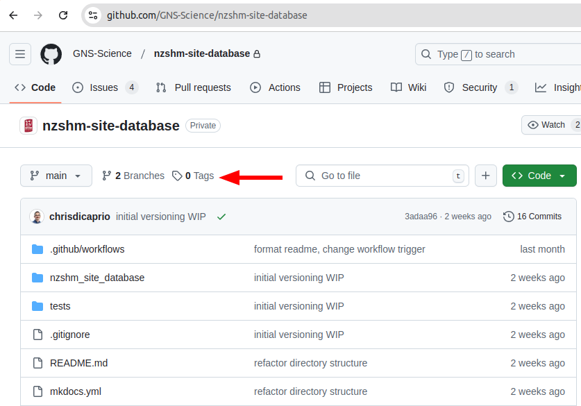
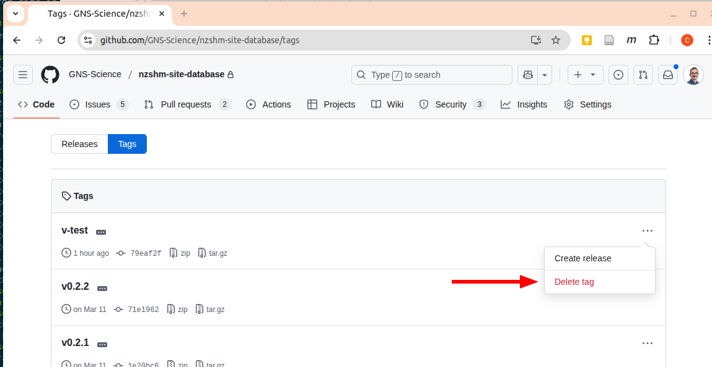
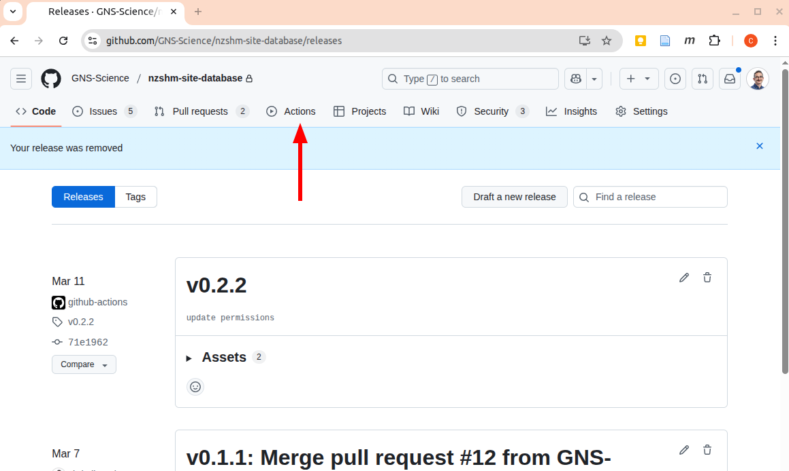
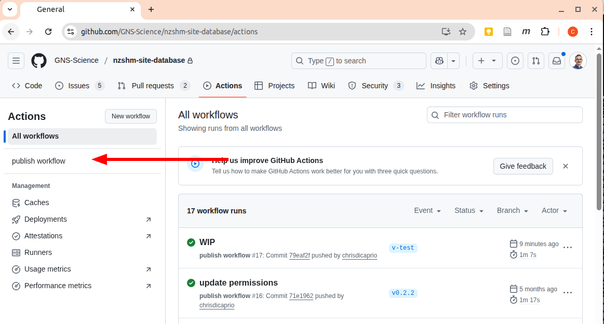
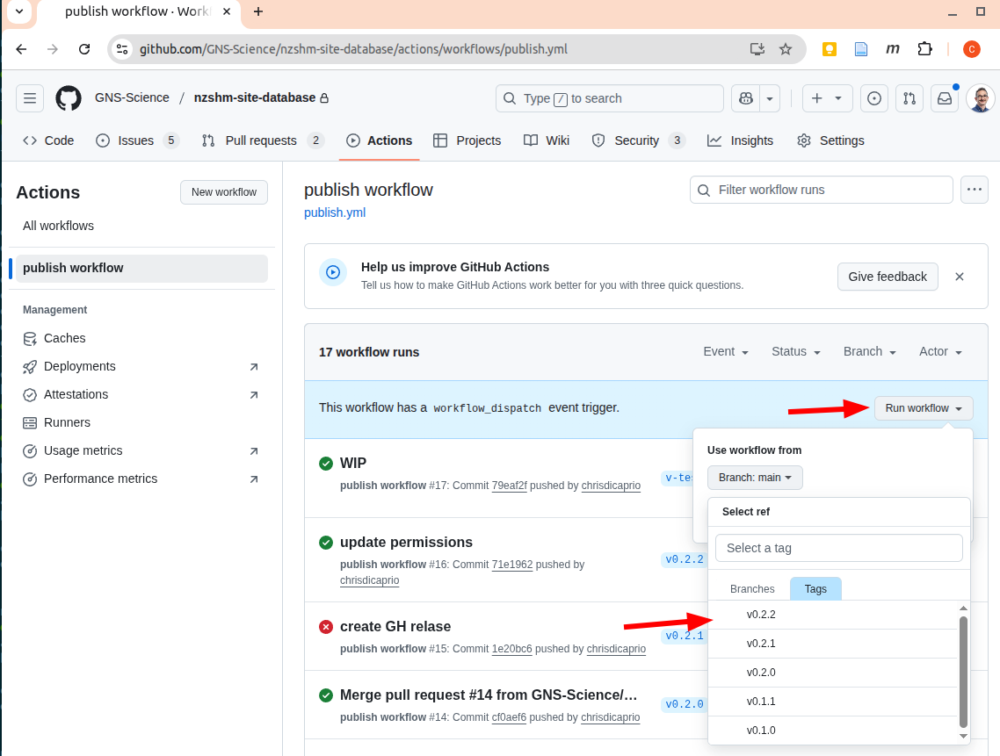

# Undoing a Release

If you create a release of the database in error follow these steps to roll back to the previous release.

On GitHub, go to releases

Click the delete icon for the release

Click on tags and delete the tag

Now you need to re-run the release process. Go to Actions

Click on "publish workflow"

Click on "Run workflow" and select the most recent, correct tag.

