# Updating the Database

## Using git CLI on your computer

Fetch and merge any changes on the `main` branch from the remote server and then create a new branch
```console
$ git switch main
$ git pull
$ git checkout -b new-branch
```
where `new-branch` is the name of your branch. Give it an informative name.

Then add or modify files.

Add files and commit changes
```console
$ git add file1 file2 file3
$ git commit -m "added files 1 2 and 3"
```

Push the commits to the remote (GitHub)
```console
$ git push --set-upstream origin new-branch
```

## Using GitHub web

### create a new branch
From the top level page of the repository (https://github.com/GNS-Science/nzshm-site-database), click "Branches"

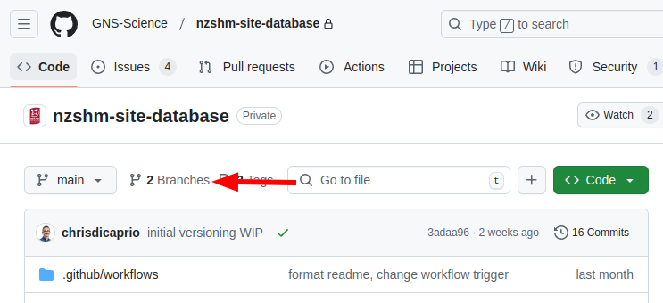

Click on "New branch"

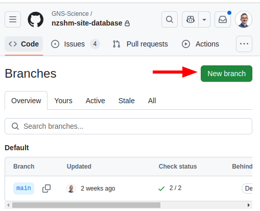

Click on your new branch so that changes are made on it.

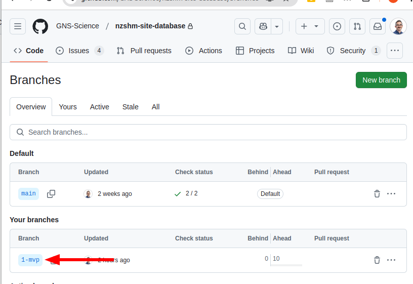

### adding files
Navigate to the location in the repository where you want your new file to appear. Click "Add file". You can type a new file in place, or upload one:

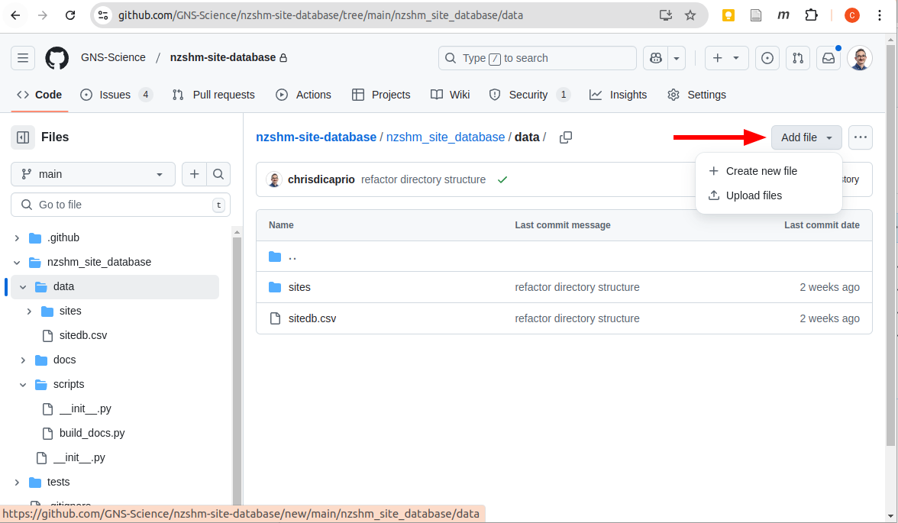

Keep the default to commit directly to your branch that you created above.

After adding your files, write a description of your changes and click "Commit changes"

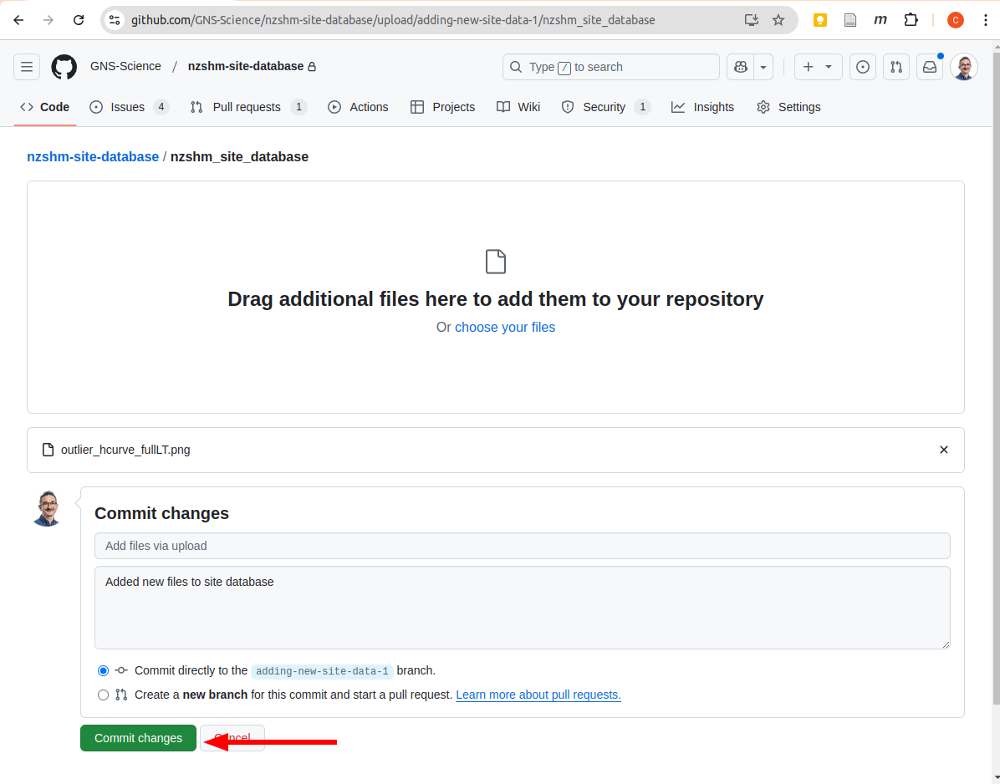


## Create a PR
Once you have made all changes and additions, you will create a pull request (PR). On the top level page of the repository on GitHub (https://github.com/GNS-Science/nzshm-site-database), you may see a button to create a PR:

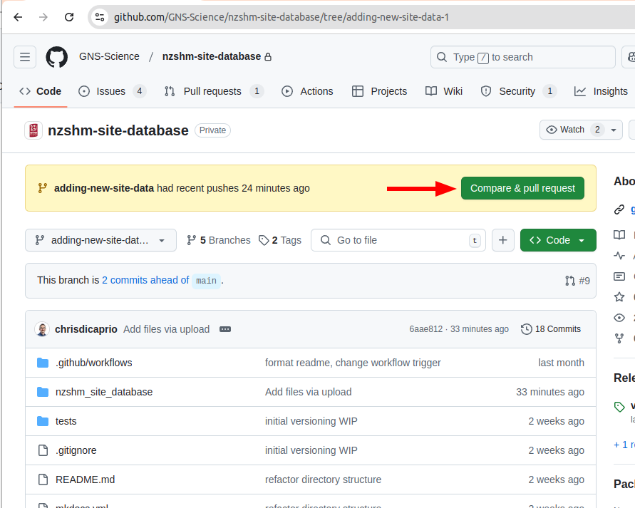

If not, select your branch following the steps above and select "Contribute", "Open pull request"

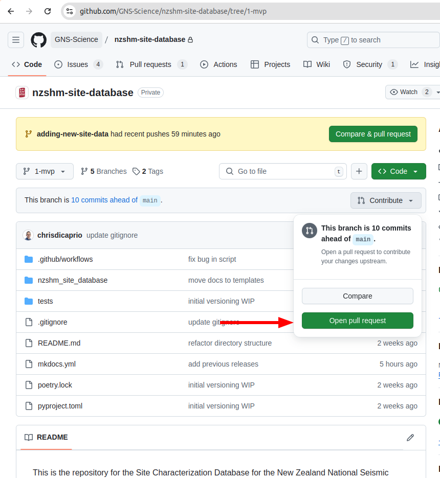

Type a description of the additions and click "Create pull request"

## Tagging a release
Once a PR has been approved and merged, you can tag the release which will publish a new database website.

### using the git CLI
First, pull updates to the repository to your local clone and switch to the main branch
```console
$ git pull
$ git switch main
```

Tag the release based on the [versioning system](versioning.md) and push the tag to the remote.
```console
$ git tag v0.2.0
$ git push origin tag v0.2.0
```
This will trigger the build process and publish a new database website.

### using GitHub web
From the top level page, click on "Tags"

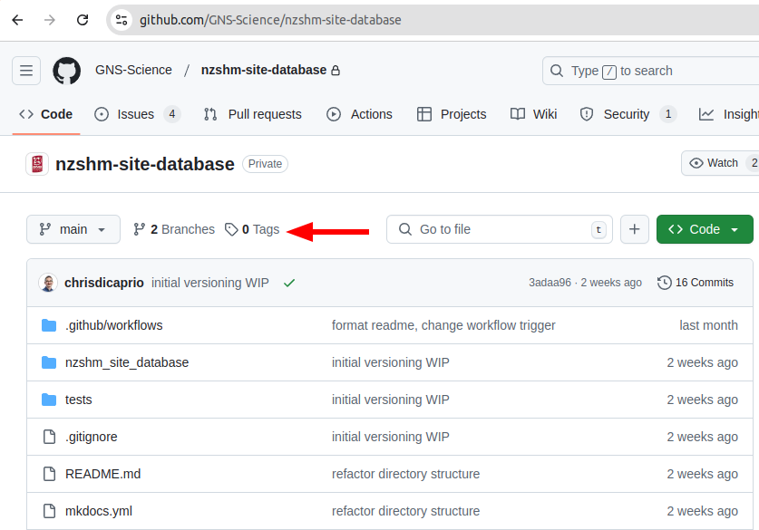

And "Releases"

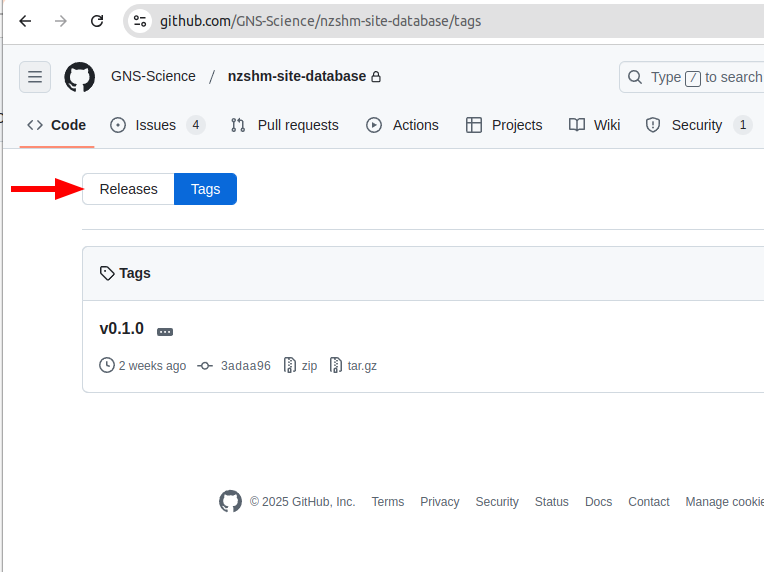

Click "Draft a new release"

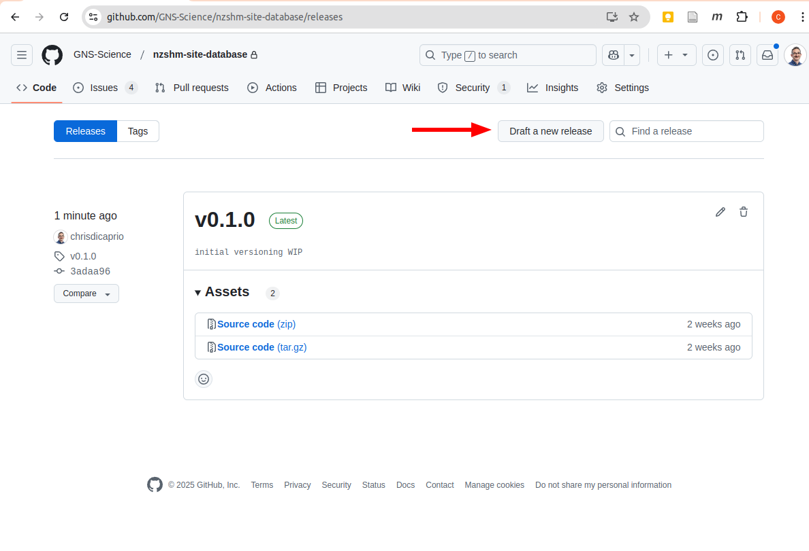

Create a new tag based on the [versioning system](versioning.md) and select "+ Create new tag: ..." **Be sure the "Target" branch is set to "main"**

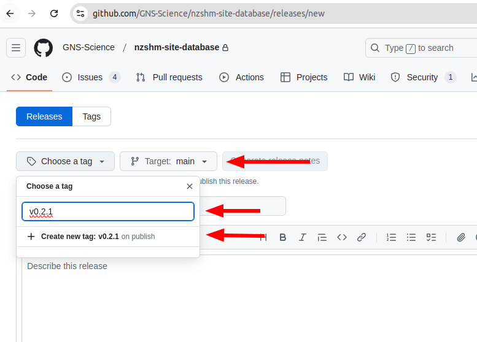

Click "Publish release"

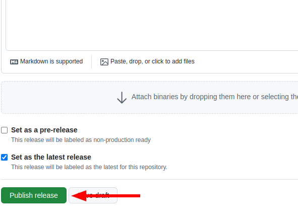

This will trigger the build process and publish a new database website.